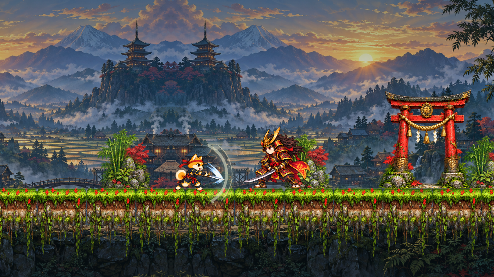

# Kiba: Three Realms

[Magyar](README.md)

A little shiba samurai. Three realms. A father to bring home.

**[Play in your browser →](https://k-szabo.github.io/kiba-game/)** · [Gameplay guide](docs/GAMEPLAY.en.md) · [Development guide](docs/DEVELOPMENT.md)

*A preview rendered by the game's Canvas drawing code.*

## The story

Momo, a small shiba samurai, sets out to rescue his beloved father, Haru. He travels through Japanese forests and temples, descends into the depths of Yomi, then climbs above the clouds into the heavenly realm. **Kiba** is the energy flowing through the world. It can nourish or destroy, and its currents change from one place to another: life-giving around Japanese shrines, faint in underground passages, distorted in Yomi, and powerful in the streams of the sky.

**Kiba: Three Realms** is a browser-playable 2D metroidvania with sword combat, platforming, and exploration in worlds inspired by Japanese mythology.

## Three realms, three kinds of adventure

| Realm | The journey | Enemies |
| --- | --- | --- |
| **Japan — The Way of the Bells** | Forest paths, village rooftops, river tunnels, and a bamboo temple. The forest and village bells reveal the way forward. | Samurai, archers, shielded soldiers, and onmyoji mages. |
| **Yomi — The Underworld** | Descend through the depths, free captive souls, and cross ash platforms and lava-filled chambers. | Oni demons, tengu, summoned minions, and a demon guardian. |
| **Takamagahara — The Heavenly Realm** | Rise on wind streams through moving cloud islands and celestial seals. | Winged angels and a seraph with several forms. |

## Gameplay

- **Playable prologue:** Momo walks alone through a silent shadow world. A colossal, smoke-shrouded entity called Shadow waits by a black hole.
- **Sword and spirit dash:** Animated sword strikes, evasive movement, and enemies with distinct attack patterns. Guardians telegraph their dangerous attacks.
- **New abilities open new paths:** Double jump, spirit dash, and the Dawnblade become available during the adventure.
- **XP and upgrades:** Defeating enemies earns levels. Spend upgrade points at shrines on Momo's health, sword, and spirit dash. The spirit upgrade unlocks after acquiring the dash.
- **Shrines and fast travel:** Heal, save, and travel to known shrines on completed realms. Normal enemies respawn when you rest.
- **Exploration:** Optional paths, memories of Haru, hidden shrines, and relics guarded by minibosses reward curiosity. Some secrets change the final encounter.
- **Yomi boss fight:** The demon summons minions at health thresholds and begins two lava stages, including a fight against a Lava Serpent.
- **Hungarian and English:** Choose a language with the flag picker. The game remembers your choice in the browser.
- **Custom controls:** Choose UK or French keyboard presets, remap individual actions, and export or import bindings as JSON.
- **Local saves:** Progress is encrypted and tied to the current browser profile. Use Continue from the main menu to resume. During alpha and beta, a new game version resets progress while preserving language and control preferences.

## Controls

| Default keys | Action |
| --- | --- |
| A / D or ← / → | Move |
| Space, W, or ↑ | Jump; release and press again for double jump* |
| J or Z | Sword attack |
| K or Shift | Spirit dash* |
| E | Interact, heal, open gates, and collect items |
| U | Upgrade at a shrine |
| M | Map and fast travel |
| S + Space | Drop through a ledge |
| Esc | Pause |
| I | Open inventory and pause the game |

\* After acquiring the relevant ability. Touchscreen players can use the on-screen controls.

The default bindings are in `assets/config/keybindings.json`. Open **How to Play** from the main menu or pause menu to select a keyboard layout or remap actions. Custom bindings are saved in the browser. Export them to JSON to transfer them to another browser, then import the file there.

**Tip:** Stand under a torii gate and press E to interact. Jump into wind streams to rise.

## About the project

The **Report a bug** link in the main and pause menus opens the [bug report form](https://tally.so/r/8Nojjr) in a new tab, with no sign-in required. The game passes the version, language, current area, and a few technical details; you describe the problem before submitting. The game does not pass saves or personal data. Screenshots and a contact email are optional.

The game is built with **HTML5 Canvas**, **JavaScript**, and **CSS**. It uses Momo's animated character sprite sheet, illustrated environments, separate movement and attack animations, and lighting and particle effects drawn in the game.

The site is static and hosted on GitHub Pages. You do not need an account or a server-side application to play. For local development, use an HTTP server so browser storage and saves work correctly. The generated `runtime.js` is included in the repository. See the [development guide](docs/DEVELOPMENT.md) for local setup, checks, and Pages publishing.

## Documentation

- [Gameplay, abilities, and saves](docs/GAMEPLAY.en.md) · [Magyar játékmeneti útmutató](docs/GAMEPLAY.md)
- [Yomi boss and Lava Serpent](docs/YOMI-BOSS.md) — summon thresholds, both lava stages, and the serpent scale.
- [The Four Councillors' Hall](docs/COUNCIL-BRANCH.md) — the chained gate, bone key, and empty demonic castle interior.
- [Inventory and items](docs/INVENTORY.md) — backpack, equipment, relics, and item icons.
- [Prologue](docs/PROLOGUE.md) — the dream, Shadow, and Momo's awakening.
- [Development guide](docs/DEVELOPMENT.md) — local setup, checks, and GitHub Pages.
- [Agents, skills, and QA approval flow](docs/AGENT-WORKFLOW.md)
- [Repository and asset maintenance](docs/DEVELOPMENT.md#repository-és-takarítás)
- [Art direction and asset guide](docs/ART-DESIGN.md)
- [Character and asset color-map reference](assets/config/colormaps.json)
- [Release IDs and bug-fix history](docs/RELEASES.md)
- [Art prompts and reference provenance](docs/art-prompts/README.md)
