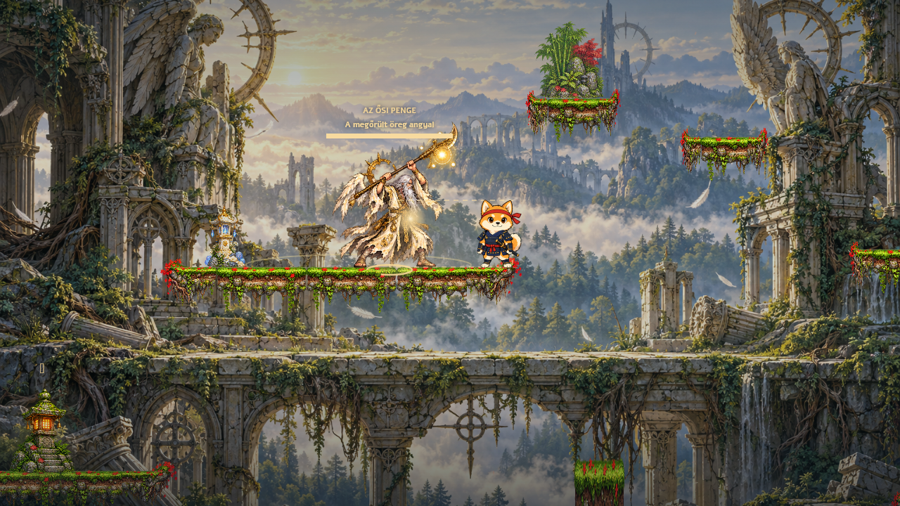
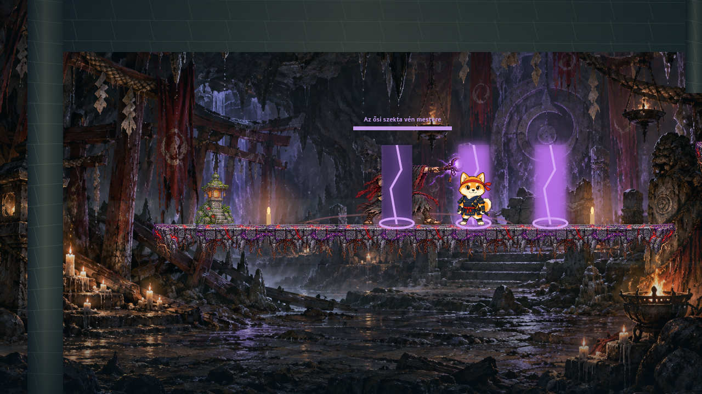

# 0.6 – Az elfeledett őrzők

Két új titkos hely, külön minibossok, képességhez kötött fejlesztés és erősebb végső őrző. Az élő oldalon frissítés után a főmenü **V0.6 · AZ ELFELEDETT ŐRZŐK** felirata jelzi ezt a változatot.

## Titkos helyek

A két ereklye már nem a korábbi, rövid mellékösvényeken vár. A titkos területek párkányai és tárgyai csak a hely felfedezése után jelennek meg a térképen; a jutalom helyét a térkép az őrző legyőzéséig nem jelöli. A fő küldetés változatlanul a két harang felé vezet.

<details>
<summary>A helyek és az őrzők részletei – spoilerek</summary>

### Az ősi angyaltorony romjai

Japán lombkoronája fölött egy romos torony rejtőzik. Szűk, eltolt párkányain kettős ugrással kell feljutni, majd a belső szentélyhez ereszkedni. A glória csak a **megőrült öreg angyal** legyőzése után válik elérhetővé.

Az angyal 36 HP-val és három támadással rendelkezik: előre jelzett széles pengevágás, három fénynyílból álló legyező és roham. A felemelt fegyver és a talajra rajzolt jelzés segít a kitérésben.



### Az elfeledett szekta barlangja

A folyó alatti járatból egy repedezett, karddal feltörhető sziklafal mögé vezet az út. A lejárat lépcsőiről mélyebb barlangszentélybe lehet ereszkedni. A kamra sziklás födéme és oldalfalai megakadályozzák, hogy a főútról közvetlenül a jutalomra essen a játékos.

A **szekta vén mestere** 42 HP-val őrzi a démonlord szarvát. Rituális közelharci vágást, célzott árnyékátkot és késleltetve aktiválódó földi pecséteket használ. Minden támadásának külön előjelzése van.



Mindkét minibossnak saját, hat pózból álló animációs készlete és helyi életerőjelzője van. Legyőzésük 80, illetve 95 XP-t ad. A legyőzött miniboss nem éled újra gyógyuláskor; a normál ellenfelek továbbra is újraélednek. Halálkor, a terület elhagyásakor és gyorsutazáskor a befejezetlen miniboss-harc visszaáll, a hozzá tartozó lövedékek és veszélyek eltűnnek.

</details>

## Fejlesztés

A **Szellem** fejlesztés gombja zárolt, amíg Kiba nem szerzi meg a szellemlépést. A menü megmutatja a feltételt, és a pontköltés logikája is ellenőrzi a képességet. Életerőt és kardot továbbra is lehet fejleszteni előtte. A korábbi mentésben már kiosztott szellempontok megmaradnak.

## Az angyal őrző

A rendes angyal és az 50%-nál bekövetkező sötét alakváltás közös életereje **50-ről 140 HP-ra** nőtt: két, nagyjából 70 HP-s szakasz. Az alakváltás továbbra sem gyógyít. A rejtett harmadik forma **180 HP-ra** töltődik fel.

Mindhárom forma a varázslatai mellett önálló közelharci szárnyvágást használ. A normál alakok 0,8, a titkos alak 0,65 másodperc előjelzést adnak. A támadás iránya az előkészítés kezdetén rögzül, így a boss mögé kerülve is kitérhetsz. A vágás a normál alakokban 2, a titkosban 3 sebzést okoz; a mágikus támadássor közben is működik. Az angyal az üresjáratokban közelebb lép a játékoshoz.

## Mentések és frissítés

A mentés kulcsa és formátuma megmaradt. A képességek, statok, korábbi győzelmek és már felvett ereklyék tovább használhatók. Új játékból lehet végigjátszani az új keresést és az őrzőket; a régi ereklyék nem kerülnek ki a gyűjteményből.

A teljes frissítéshez a JavaScript-fájlokon túl az **új négy v6 PNG** és a frissített **art-data.js** is kell. A v3 hátterek és a v4/v5 aktív képek továbbra is szükségesek. A négy új illusztráció a beépített ImageGen eszközzel készült; a [promptok](V06-ART-PROMPTS.json) a dokumentációban megtalálhatók. A PNG-k változatlanul kerültek a játékba, az animációs kivágásokat átlátszó határok mentén ellenőrzött metadata választja el.

## Ellenőrzés

```sh
node scripts/check-site.mjs
node scripts/test-combat.cjs
node scripts/test-v05.cjs
node scripts/test-v06.cjs
node scripts/test-routes.cjs
```

Az új tesztek ellenőrzik a zárolt pontköltést és a képesség tényleges megszerzése utáni feloldását, az ereklyék őrzőhöz kötését, a tényleges kardcsapásokkal legyőzhető minibossokat, az egyszeri XP-t, a mentést, a harcok visszaállítását, valamint az angyal közelharcának előjelzését, sebzését és a közben folytatódó varázslatokat. Az útvonalkeresés a játék mozgásfüggvényeivel vizsgálja a titkos helyek és a visszautak elérhetőségét. Az előnézetek a játék tényleges Canvas-kódjával készültek.
